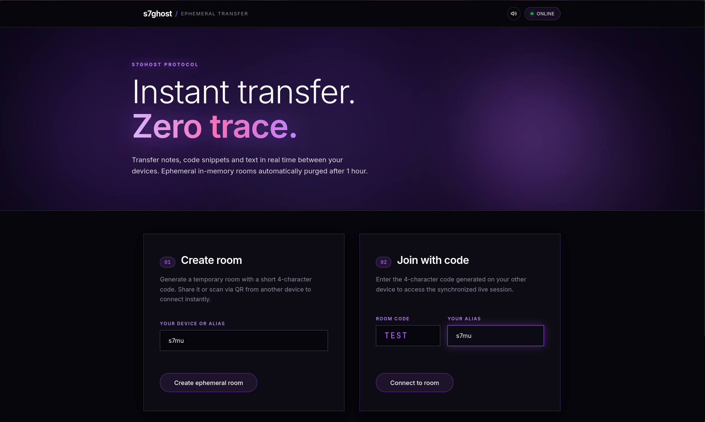

# s7ghost

> Instant transfer. Zero trace.  
> Lightweight, ephemeral text and code transfer tool between devices. Runs 100% in volatile RAM with zero disk persistence.

[](https://nodejs.org)
[](https://docker.com)
[](LICENSE)

<br>



---

## Features

- **Peer Sync**: Bidirectional real-time synchronization between devices via WebSockets with automatic HTTP polling fallback.
- **Client-Side Encryption (E2EE)**: Messages encrypted directly in the browser via native Web Crypto API (AES-GCM-256) using a key derived from the room code.
- **In-Memory Only**: Zero disk storage or persistent database. Rooms, messages, and sessions live solely in RAM.
- **1-Hour TTL**: Rooms automatically self-destruct after 1 hour from creation or inactivity.
- **Panic Button**: Instantly incinerates the active room and wipes all data from RAM on all connected devices in real time.
- **Burn-After-Read**: Optional self-destructing notes with a 10-second countdown.
- **QR Code Pairing**: Direct room connection by scanning a generated QR code from any mobile camera.
- **Code Snippet Support**: Automatic syntax detection for code, JSON, and terminal commands with one-click copy.
- **Native Web Audio**: Oscillator-synthesized sound effects and haptic vibration without external audio files.

---

## Quick Start (Docker)

```bash
git clone https://github.com/s7mu/s7ghost.git
cd s7ghost

docker build -t s7ghost .
docker run -d -p 3000:3000 --name s7ghost s7ghost
```

Open `http://localhost:3000`.

### Docker Compose

```yaml
services:
  s7ghost:
    build: .
    container_name: s7ghost
    restart: unless-stopped
    ports:
      - "3000:3000"
    environment:
      - PORT=3000
      - HOST=0.0.0.0
```

```bash
docker compose up -d
```

---

## Local Development

Requirements: Node.js 20+

```bash
npm install
npm test
npm start
```

Available on `http://localhost:3000`.

---

## Reverse Proxy

### Nginx

`s7ghost` includes an automated 30-second WebSocket heartbeat ping to prevent Cloudflare or reverse proxies from dropping inactive connections (100s timeout).

```nginx
server {
    listen 80;
    server_name yourdomain.com;

    location /ws {
        proxy_pass http://localhost:3000/ws;
        proxy_http_version 1.1;
        proxy_set_header Upgrade $http_upgrade;
        proxy_set_header Connection "Upgrade";
        proxy_set_header Host $host;
        proxy_read_timeout 86400s;
    }

    location / {
        proxy_pass http://localhost:3000;
        proxy_set_header Host $host;
        proxy_set_header X-Real-IP $remote_addr;
        proxy_set_header X-Forwarded-For $proxy_add_x_forwarded_for;
        proxy_set_header X-Forwarded-Proto $scheme;
    }
}
```

---

## Testing

```bash
npm test
```

---

## License

[MIT](LICENSE) © 2026 Samu
